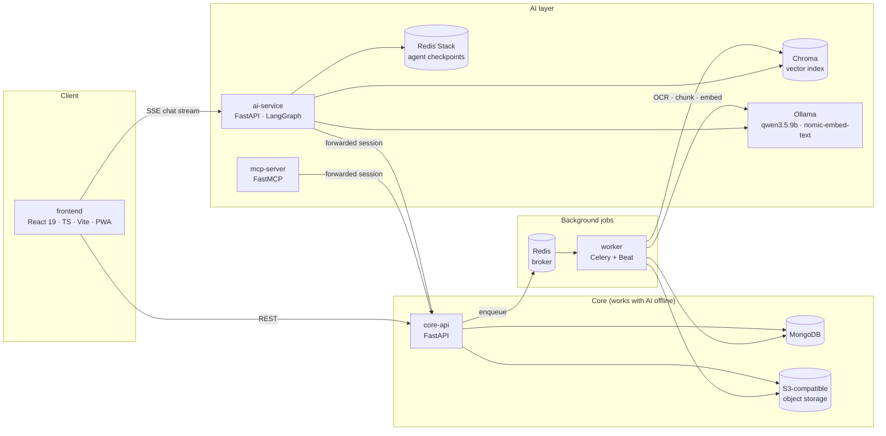

# ARIA — Adaptive Residential Intelligence Assistant

[](https://github.com/TheRoaringPigeon/ARIA/actions/workflows/ci.yml)

A self-hosted, AI-assisted home operations platform. ARIA tracks the things a
household owns and maintains (home systems, vehicles, equipment, projects,
people), logs what happened to them, schedules what's coming due, ingests the
manuals and receipts that go with them, and lets household members ask
questions in plain language. Answers are grounded in the household's own
records and documents, with citations back to the source page.

All LLM inference and embedding runs locally on a single consumer GPU via
Ollama. No household data leaves the machine for model calls.

## What it does

- **Track and schedule.** CRUD for entities across five domains, a unified
  activity log, and recurring maintenance schedules whose due dates
  recompute when a matching log is recorded. A daily digest emails what's
  overdue. All of this works with the AI services turned off.
- **Ingest documents.** Upload a PDF or snap photos on a phone. A Celery
  pipeline runs OCR, splits the text into section-aware chunks with page
  numbers preserved, embeds them, and indexes them in a vector store. Each
  document reports its stage (`pending → ocr_complete → chunked → embedded`).
  Scanned photos are exported as searchable PDFs with an invisible text layer.
- **Ask questions.** A chat interface with retrieval-augmented generation
  over the household's documents and structured records. Answers stream
  token by token, show live progress while the agents work, and cite the
  document and page each fact came from.
- **Take actions from chat.** "I just changed the oil in the truck" becomes a
  proposed log entry. The agent graph pauses until the user confirms or
  cancels, and only then writes through the same validated API the UI uses.
- **Share a household.** Multi-household accounts with invites, owner/member
  roles, a permission registry, and per-household isolation of every
  query, including vector search.
- **Use it on a phone.** An installable PWA served over HTTPS, with offline
  log entry that syncs when the connection returns.

## AI and data engineering highlights

| Area | Implementation |
|---|---|
| **Unstructured data pipeline** | `worker`: Tesseract OCR → deterministic, header-aware chunking with page metadata → `nomic-embed-text` embeddings → Chroma. Idempotent stages, status tracked per document, cascade cleanup across Mongo, object storage, and the vector index on delete. |
| **Retrieval-augmented generation** | Household-scoped semantic search with a distance cutoff, plus fuzzy matching of entity names mentioned in the question against structured records. Retrieved chunks are folded into the prompt and resolved back to citations the UI links to. |
| **Multi-agent orchestration** | A LangGraph `StateGraph`: a supervisor classifies each turn and routes it to a specialist (maintenance, vehicle, research, general, action), each with its own persona and tool subset. The research agent runs a bounded tool-choice loop over document search, Brave web search, and Open-Meteo weather. Graph state is checkpointed to Redis Stack. |
| **Structured outputs** | Every internal decision (routing, tool choice, grounding gate, write-action proposal) uses JSON-Schema-constrained decoding rather than parsing free text, so a malformed decision is impossible by construction. Schemas are generated from the same constants the code validates against. |
| **Human-in-the-loop tool calling** | Write actions use LangGraph interrupts: the graph proposes, the user confirms, the graph resumes and executes. Confirm and cancel are idempotent across client retries. |
| **Model Context Protocol** | A standalone FastMCP server exposes `create_log` and `create_schedule` so external agents (e.g. Claude Code) can write to a household through the same auth and validation as the app. |
| **Model portability** | A `ModelAdapter` seam isolates model-specific behavior (reasoning-tag filtering in the stream). Routing does not depend on the model, so swapping models is a config change. |
| **Safety and abuse resistance** | Session auth on every route including chat, rate limiting on login, signup, and chat, clients cannot inject system messages, and the AI service holds no database credentials. It acts only through the core API with the user's forwarded session. |

## Architecture



Design principles:

- **Strict decoupling.** `core-api` has zero AI dependencies. Tracking,
  scheduling, and document storage keep working if the AI layer, vector
  store, or GPU is down. The AI service degrades to simpler retrieval rather
  than failing a request if orchestration breaks.
- **One canonical schema.** Domain models live once in `libs/shared` as
  Pydantic models, shared by every Python service through a `uv` workspace
  with a single lockfile. The frontend's TypeScript domain types are
  generated from those models, and a test fails CI if they drift.
- **Object storage behind `boto3`.** The same code targets local
  S3-compatible storage in dev and AWS S3 in a cloud deployment; only the
  endpoint URL changes.

## Tech stack

**Backend:** Python 3.12, FastAPI, Pydantic v2, Motor (async MongoDB),
Celery + Beat, Redis, boto3, `uv` workspaces
**AI:** LangGraph, Ollama (Qwen 3.5, nomic-embed-text), ChromaDB, FastMCP,
Tesseract OCR
**Frontend:** React 19, TypeScript, Vite, Tailwind CSS, TanStack Query,
Workbox (PWA and offline sync)
**Infra:** Docker Compose, Caddy (automatic HTTPS), GitHub Actions, GHCR

## Engineering practices

- **~560 automated tests** across the five Python packages (pytest, async
  Mongo test doubles, mocked LLM and HTTP boundaries).
- **CI on every push and PR:** per-package test matrix, Docker image builds
  for every service (pushed to GHCR from `main`), frontend type-check and
  lint, and pre-commit hooks (ruff plus the schema drift check).
- **Design docs for every milestone** (`docs/plans/`) and a tracked
  **scaling-debt register** (`docs/scaling-debt.md`) with a severity, a
  rationale, and a written plan for each item fixed
  (`docs/scaling-debt-plans/`). A separate register (`docs/aws-migration.md`)
  tracks what a move to AWS would require.

## Quick start

Requires Docker with Compose. The model server expects an NVIDIA GPU; for
CPU-only, remove the `deploy`/`runtime` lines in `docker-compose.llm.yml`.

```
docker compose -p aria-llm -f docker-compose.llm.yml up -d --build   # Ollama, shared by dev and prod
docker compose up --build
```

The first start pulls the model, so it takes a while. Then:

| | URL |
|---|---|
| App | http://localhost:5173 (dev login seeded automatically) |
| core-api docs | http://localhost:8000/docs |
| ai-service docs | http://localhost:8001/docs |

Copy `.env.example` to `.env` to override defaults. Web search in the
research agent needs a Brave Search API key; everything else runs without
external keys.

Running the tests for one package (from that package's directory):

```
uv run --package core-api pytest
```

## Documentation

| Doc | What's in it |
|---|---|
| [`docs/architecture.md`](docs/architecture.md) | Codebase walkthrough, service by service |
| [`docs/data-model.md`](docs/data-model.md) | Collections, fields, and why they're shaped that way |
| [`docs/roadmap.md`](docs/roadmap.md) | Milestones and what each delivered |
| [`docs/scaling-debt.md`](docs/scaling-debt.md) | Known scaling and robustness gaps, ranked |
| [`docs/aws-migration.md`](docs/aws-migration.md) | What a move to AWS requires |
| [`docs/operations.md`](docs/operations.md) | Prod deployment, backups, restores, migrations |

## Repo layout

```
pyproject.toml       root uv workspace definition (no installable root package)
uv.lock              single lockfile for the whole workspace
libs/
  shared/            aria-shared: Pydantic domain models used by every Python service
  auth/              aria-auth: sessions, roles, and the permission registry
services/
  frontend/          React PWA
  core-api/          CRUD, auth, documents, exports
  ai-service/        chat, agents, retrieval, MCP server
  worker/            ingestion pipeline and scheduled jobs
docker/              shared Python service Dockerfile, Ollama entrypoint
scripts/             PowerShell backup, restore, and MCP login helpers
docs/                design docs, plans, debt registers
```
